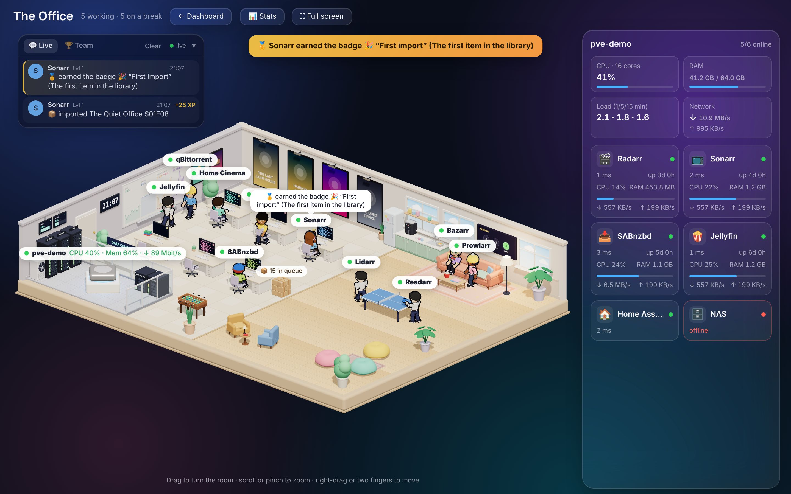
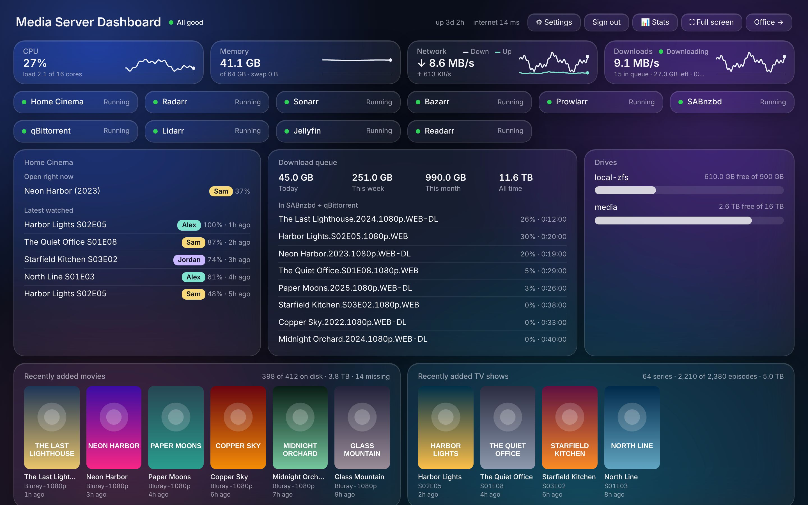
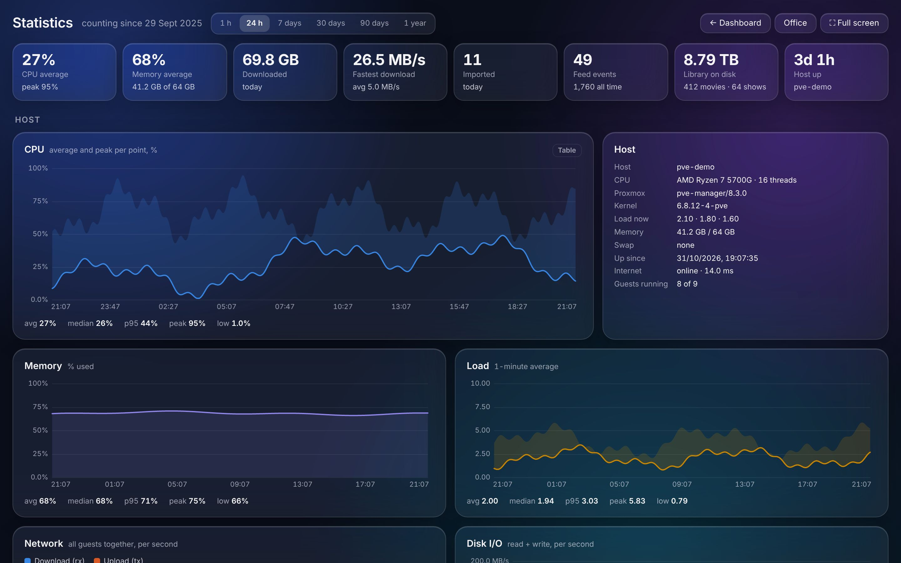
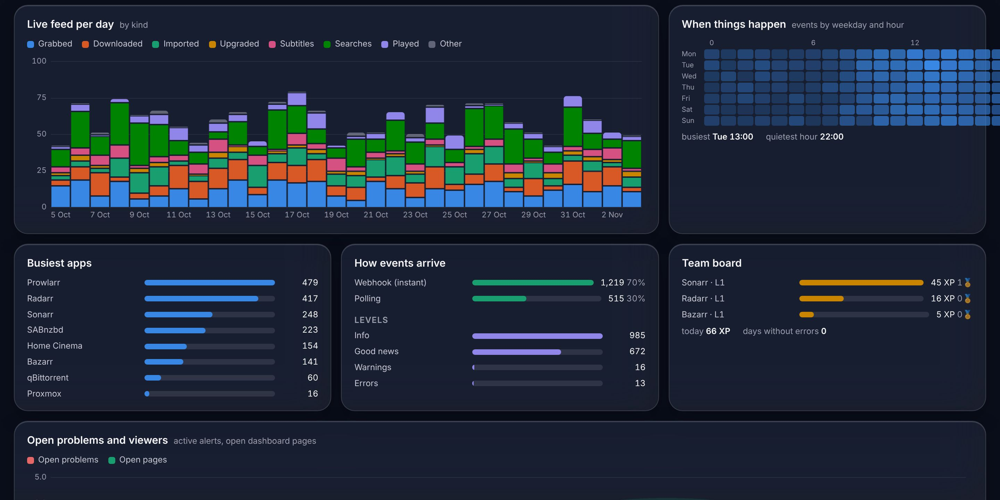
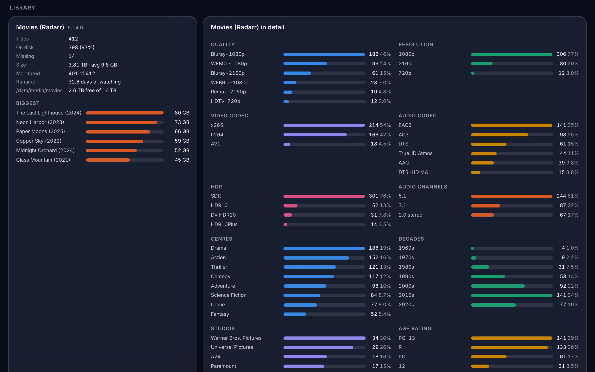
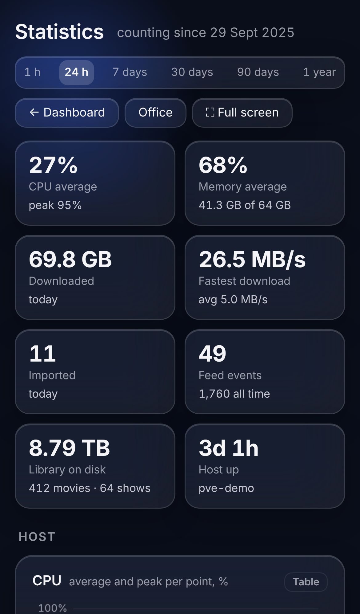
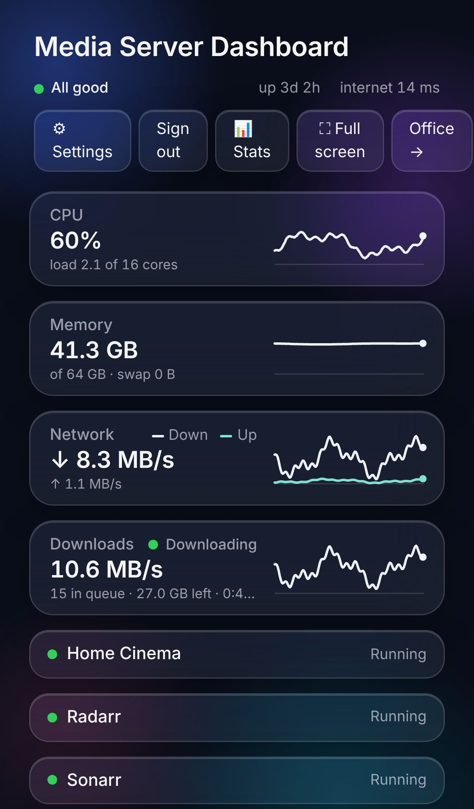

# Media Server Dashboard · Extended

A dashboard for a homelab media stack (Radarr, Sonarr, Prowlarr, Bazarr, SABnzbd, NZBGet, qBittorrent, rdtclient, Jellyfin and more) plus a 3D
office where your apps are the employees. This edition runs on **Proxmox (LXC)**, in **Docker** and on
a **Synology**, and watches everything over the network.

> **Credits:** This project is based on
> [Media Server Dashboard](https://github.com/Essq1337/media-server-dashboard) by
> **[Essq1337](https://github.com/Essq1337)**. The idea, the dashboard and the whole 3D office with its
> staff come from there. Thank you! The original is MIT-licensed and built for a Mac; this edition
> brings it to Proxmox, Docker and Synology and extends it (see below). The original copyright notice
> remains in [LICENSE](LICENSE).

<p align="center"></p>

## Screenshots

All of them with the made-up data of `python3 server.py --demo`.

| Dashboard | Statistics |
|---|---|
|  |  |
| **Statistics: activity** | **Statistics: library** |
|  |  |

<p align="center"> </p>

## Features

- **Dashboard** (`/dashboard`, top right in the office): live graphs for CPU, memory, network and downloads, which services are up (hover one to see what's wrong), the SABnzbd queue, storage, recently added movies and shows, and what's coming up in the next 14 days.
- **Office** (`/`, the start page; Settings → Account can open the dashboard after signing in instead): the apps sit at their desks while they're working and wander off to the break room when they're idle. Custom apps join as extra staff.
- **Live feed** in the office: what the apps do shows up as a chat and as a speech bubble above the worker ("Radarr: imported Dune (2021) in Bluray-2160p"). It comes from the apps' webhooks and from what the dashboard notices itself, pushed live over Server-Sent Events.
- **Panic:** if the Proxmox host can't be reached, the server in the office catches fire and the staff run around shouting until it answers again.
- **Posters** open the title in Plex or Jellyfin (or Radarr/Sonarr); workers open their app.
- **Team board (gamification):** XP, levels and badges for every worker, today's numbers, a leaderboard and the days without errors. Can be switched off.
- **Start page** beside the office (left or right, tiles or a table): your own links with icons, online checks by IP:port and, for linked Proxmox guests, CPU, memory, traffic and uptime.
- **Proxmox:** host stats, storages and the state of containers and VMs through the Proxmox API, with a read-only token. Without Proxmox (Docker, Synology) the dashboard shows the machine it runs on instead: CPU, memory, load, disk I/O and the mounted drives, from `/proc`.
- **Statistics** (`/stats`, 📊 Stats): everything the dashboard sees, kept for up to two years (a point per minute for a day, per hour for 90 days, per day after that) and shown as graphs with average and peak: CPU, memory, load, network, disk I/O, download speed per client, gigabytes per day, queue length, every app's response time (median, p95, peak), indexer queries and grab rates, the feed per day, a weekday × hour heatmap, and the library taken apart: qualities, resolutions, codecs, HDR, audio, genres, decades, studios, the biggest titles and what was added per month. Plus the dashboard's own process for the curious.
- **Full screen and wall tablets:** "⛶ Full screen" (or F) on the dashboard, the office and the statistics. In kiosk mode (full screen, `?kiosk` in the address, or added to the home screen as an app) the screen stays on, the pointer hides, settings and sign-out disappear and the page refreshes itself once a night. Added to the home screen it opens full screen on the page last used.
- **Jellyfin:** who is watching what (with progress, device and whether it transcodes), the latest watched per profile, the library's numbers and "is watching" lines in the live feed. It fills the Home Cinema card and the TV above the office couch, and posters open their title in Jellyfin.
- **Download clients:** SABnzbd (API key), NZBGet, qBittorrent and rdtclient (Real-Debrid / AllDebrid, through its qBittorrent-compatible API; user and password): speed, queue, totals and finished or failed downloads in the feed. Several can run side by side; the download card shows them together, each worker its own queue.
- **Setup wizard** (`/setup`, later ⚙ Settings as tabs with a save bar): user, address (IP or a domain with HTTPS), Proxmox, apps with connection tests, custom apps with presets (Lidarr, Readarr, Whisparr, Jellyseerr, Jellyfin, Plex, Tautulli), start page, live feed and updates.
- **One-click updates** (LXC): only releases signed by this repository's release workflow are installed, with a backup, a health check and an automatic rollback. Docker and Synology update through the signed image.

Python standard library only, no build step, no accounts, no analytics.

## Installation

| Where | Guide | Updates |
|---|---|---|
| **Proxmox VE** (own LXC, recommended) | [docs/proxmox.md](docs/proxmox.md): one script on the host, pick storage and resources from menus | Settings → Updates (one click, signed) |
| **Docker / Docker Compose** | [docs/docker.md](docs/docker.md) | `docker compose pull && docker compose up -d` |
| **Synology** (Container Manager) | [docs/synology.md](docs/synology.md) | rebuild the project or update the image |

Then open `http://<address>/setup`, enter the **setup token** (the installer prints it; with Docker it is
in the log) and go through the wizard.

**Behind your own reverse proxy** (Nginx Proxy Manager, Traefik, Synology …), point it at:

| Install | Forward to | More |
|---|---|---|
| Proxmox LXC | `http://<container IP>:80` (Caddy; the dashboard itself only listens on 127.0.0.1:8900) | choose "Behind my own reverse proxy" in the wizard, [docs/proxmox.md](docs/proxmox.md#behind-nginx-proxy-manager-or-another-proxy) |
| Docker / Synology | `http://<Docker host>:8900` (the published port), or `http://media-server-dashboard:8900` on a shared Docker network | set `MSD_TRUSTED_PROXIES`, [docs/docker.md](docs/docker.md#behind-a-reverse-proxy-https) |

To just try it with made-up data:

```bash
python3 server.py --demo
```

Then open http://localhost:8900.

## Live feed and webhooks

Without any setup the dashboard reports what it sees while polling: finished downloads, new imports,
searches, problems and guests that stop. With webhooks everything arrives at once and in full. The
addresses, with instructions per app, are under **Settings → Live feed**, ready to copy:

- **Radarr, Sonarr, Prowlarr, Lidarr, Readarr:** Settings → Connect → Webhook, URL `…/hook/<token>/Radarr`
- **Bazarr, SABnzbd:** notifications through Apprise with `json://…/hook/<token>/Bazarr`
- **qBittorrent, rdtclient:** nothing to set up, finished and failed torrents are noticed by polling
- **NZBGet:** the extension in [`extras/nzbget/DashboardNotify`](extras/nzbget/DashboardNotify) (copy it into NZBGet's scripts folder, paste the URL as its WebhookUrl)
- **Jellyfin:** Webhook plugin, generic destination (template in the settings)
- **Your own scripts:** `curl -X POST …/hook/<token>/Backup -H 'Content-Type: application/json' -d '{"text": "Backup done"}'`

## Updates and releases

The pipeline works like a signed-release update sidecar:

1. `scripts/release.sh 0.3.0` sets `VERSION`, turns "Unreleased" in the [CHANGELOG](CHANGELOG.md) into the release's section, commits and tags.
2. `git push origin main v0.3.0` starts [`.github/workflows/release.yml`](.github/workflows/release.yml). It runs the whole CI (Debian 12 and 13), builds the archive and `release.json` with its SHA-256 and the [release policy](.release-policy.json), and **signs `release.json` keyless with Sigstore** under its own identity. Then it builds the container image for amd64 and arm64, tests, signs and verifies it, and only then publishes the GitHub release.
3. On every LXC installation the update service (root, `updater/msd-updater.py`) looks for releases daily and on request. It installs only if the signature comes from **exactly this workflow at exactly this tag**, the version is newer and the policy allows it. It backs up the settings, unpacks next to the running version, switches over, restarts and runs a health check. If the new version doesn't answer, the previous one runs again.

The app itself can't install anything: it only leaves a request that the update service checks.
Installing needs the password; automatic installation at a set hour can be switched on.

To check an image by hand:

```bash
cosign verify ghcr.io/freelancer381/media-server-dashboard-extended:0.2.0 \
  --certificate-identity "https://github.com/freelancer381/media-server-dashboard-extended/.github/workflows/release.yml@refs/tags/v0.2.0" \
  --certificate-oidc-issuer https://token.actions.githubusercontent.com
```

## Security

- Everyone signs in (user and password, PBKDF2). Before the first setup, the wizard only opens with the setup token.
- API keys and the Proxmox token stay on the server (`config.json`, mode 600) and never reach the browser.
- For Proxmox the `PVEAuditor` role (read-only) is enough. The dashboard never changes anything on the host or in the apps.
- Webhooks need the secret token in the URL, are limited to 120 a minute and only take JSON. A new address is one checkbox in the settings.
- After eight wrong logins the real client address is locked out for five minutes, also behind a reverse proxy (`trusted_proxies` or `MSD_TRUSTED_PROXIES`, addresses or ranges such as `172.16.0.0/12`).
- Don't expose it to the internet without HTTPS.

## Development

```bash
python3 -m unittest discover -s tests   # unit tests (live feed, server, updater against a fake GitHub)
python3 tests/smoke.py                  # starts the server and goes through setup, login, webhooks, SSE and updates
python3 server.py --demo                # demo with made-up data and a live feed
```

## License

MIT, see [LICENSE](LICENSE). Based on [Essq1337/media-server-dashboard](https://github.com/Essq1337/media-server-dashboard) (MIT).
The 3D office uses [three.js](https://threejs.org) (MIT), bundled in `vendor/`.
